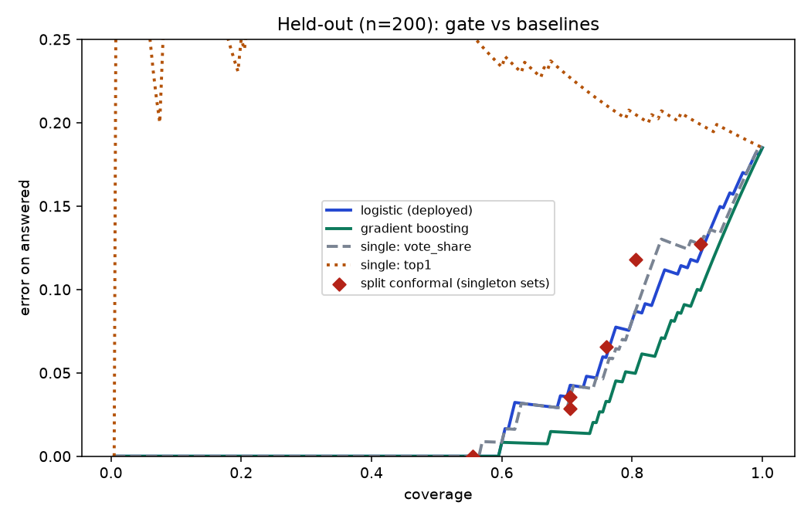

# Baselines: does the learned gate earn its place?

Same 4,000-query leave-one-out pool and 200 held-out queries as `reliability.md`. Lower AURC and lower risk are better; higher coverage is better.

| Method | AURC (cal) | AURC (held-out) | Error @80% cov (held-out) | Coverage @10% err (cal) | Coverage @10% err (held-out) |
|---|---|---|---|---|---|
| gradient boosting | 0.0286 | 0.0257 | 5.0% | 88.2% | 90.5% |
| logistic (deployed) | 0.0379 | 0.0349 | 8.1% | 82.5% | 83.5% |
| logistic + isotonic | 0.0386 | 0.0353 | 8.1% | 81.8% | 83.0% |
| single: vote_share | 0.0408 | 0.0355 | 8.1% | 80.9% | 81.5% |
| single: entropy | 0.0436 | 0.0381 | 8.1% | 80.0% | 81.5% |
| single: agree_frac | 0.0490 | 0.0451 | 11.2% | 76.1% | 78.0% |
| single: top1 | 0.2546 | 0.2594 | 20.6% | 1.7% | 0.5% |
| single: mean_topk | 0.2593 | 0.2329 | 18.8% | 0.8% | 1.0% |
| single: gap12 | 0.2600 | 0.2888 | 18.8% | 0.1% | 0.0% |

Calibration error (ECE): logistic (deployed) 0.047 (cal) / 0.071 (held-out), gradient boosting 0.012 (cal) / 0.046 (held-out), logistic + isotonic 0.009 (cal) / 0.064 (held-out)

## Split conformal prediction

Abstain unless the conformal set holds exactly one category. `contains truth` should be at least 1 - alpha if the guarantee holds.

| alpha | answered | error on answered | set contains truth | mean set size | deployed gate error at same coverage | vote-share error at same coverage |
|---|---|---|---|---|---|---|
| 0.02 | 55.5% | 0.0% | 94.5% | 1.80 | 0.0% | 0.0% |
| 0.05 | 55.5% | 0.0% | 94.5% | 1.80 | 0.0% | 0.0% |
| 0.08 | 70.5% | 2.8% | 93.0% | 1.35 | 4.3% | 3.5% |
| 0.1 | 76.0% | 6.6% | 92.0% | 1.27 | 5.9% | 5.3% |
| 0.15 | 80.5% | 11.8% | 85.0% | 1.19 | 8.7% | 8.7% |
| 0.2 | 90.5% | 12.7% | 79.5% | 0.92 | 12.2% | 12.7% |
| 0.3 | 70.5% | 3.5% | 68.0% | 0.70 | 4.3% | 3.5% |

