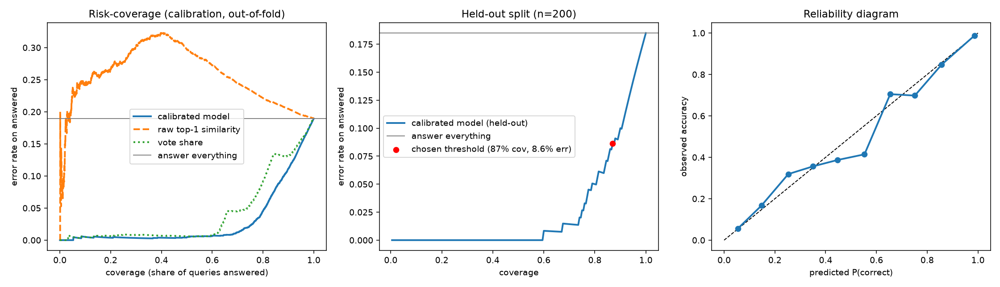

# Reliability report: when should the system abstain?

- Index: **48,178** records, k=5. Confidence model fit on **4,000** leave-one-out knowledge-base queries; tested on **200** held-out queries never indexed.
- Target: error on answered queries <= **10%** -> abstention threshold tau = **0.2713**

## Headline

Answering everything is correct **81.5%** of the time on held-out queries. With the confidence gate, the system answers **87.0%** of queries at **8.6%** error (95% CI 4.6% to 12.6%) and escalates the rest to a human.

| | coverage | error on answered | baseline error (answer all) |
|---|---|---|---|
| calibration (out-of-fold) | 88.2% | 10.0% | 18.9% |
| held-out | 87.0% | 8.6% | 18.5% |

## Which signal ranks answers best? (AURC, lower is better)

| signal | calibration | held-out |
|---|---|---|
| calibrated_model | 0.0285 | 0.0257 |
| raw_top1 | 0.2546 | 0.2594 |
| vote_share | 0.0408 | 0.0355 |
| random | 0.1890 | 0.2055 |

## Pooled numbers hide a data-mix effect (Simpson's paradox)

The data mixes short templated tickets (`bitext`, easy) with long free-text tickets (`tickets`, hard). Pooled, raw similarity ranks answers *worse than random*, because easy short queries score lower similarity than hard long ones. Within each source it is a weak but positive signal. Per-source behaviour of the gate on the held-out split:

| source | n | answer-all accuracy | coverage | error on answered |
|---|---|---|---|---|
| bitext | 102 | 100.0% | 100.0% | 0.0% |
| tickets | 98 | 62.2% | 73.5% | 20.8% |

Within-source AURC on the calibration pool (lower is better):

| source | calibrated | raw top-1 | vote share | random |
|---|---|---|---|---|
| bitext | 0.0000 | 0.0000 | 0.0000 | 0.0000 |
| tickets | 0.1418 | 0.2869 | 0.2103 | 0.3839 |

Calibration error (ECE): 0.011 out-of-fold, 0.046 held-out.
Gate model: `gb`. Permutation importance (log-loss increase when shuffled): {'top1': 0.0454, 'mean_topk': 0.0162, 'gap12': 0.0127, 'vote_share': 0.2971, 'agree_frac': 0.2798, 'entropy': 0.8072}

## Knowledge gaps (clusters of queries the system abstains on)

**1. issue, problem, project** - 109 queries (22% of abstentions), mean confidence 0.095, mostly `TECHNICAL SUPPORT` (29%)
  - "Customer Support,  Encountering connectivity problems on multiple devices related to the software. This could be due to conflicting software updates or hardware compatibility issues.  "
  - "Server Problem Impacting Several Products Detected
Customer Support, I am reporting an incident involving multiple affected products, including Microsoft Office, PostgreSQL, Git, and Oracle Database. The issue appears to be caused by a serv"

**2. integration, project, project management** - 74 queries (15% of abstentions), mean confidence 0.108, mostly `CUSTOMER SERVICE` (22%)
  - "Support for Project Management SaaS Solutions
Is it possible to get more information on the integration capabilities of your project management SaaS products?"
  - "Support Request for Smartsheet Integration
Hello customer support, I am reaching out to inquire about integrating the Smartsheet SaaS project management platform. Could you provide me with the details and necessary steps required for the in"

**3. security, data, medical** - 67 queries (14% of abstentions), mean confidence 0.118, mostly `TECHNICAL SUPPORT` (22%)
  - "Customer Support, reporting a serious incident that compromised the security of medical data on hospital systems. There was unauthorized access, which may have been due to a security vulnerability caused by employee negligence. Despite our "
  - "Customer Support, concerning a serious incident that compromised the security of medical data on hospital systems, there has been unauthorized access, suggesting a potential security vulnerability likely due to employee negligence. Although"

**4. investment, data, analytics** - 61 queries (12% of abstentions), mean confidence 0.119, mostly `TECHNICAL SUPPORT` (23%)
  - "Dear Customer Support,   I am currently preparing a report on the issue with the data analytics system. The system recently experienced a failure that impacted investment optimization. The root cause is likely a software glitch or dat"
  - "Problem with Investment Data Analysis Tools
An issue has arisen with the investment data analysis tools. Recent software updates and configuration changes might be the cause. We have restarted the affected systems and checked for updates."

**5. analytics, investment, data analytics** - 53 queries (11% of abstentions), mean confidence 0.155, mostly `PRODUCT SUPPORT` (32%)
  - "Inquiry About Available Data Analytics Tools for Investment Optimization
I reached out to Customer Support to inquire about the data analytics tools that can help optimize investment strategies. Could you provide details on the types of too"
  - "Improving Data Analytics Capabilities for Investment Optimization
Customer support has received a request to enhance data analytics tools used for investment decision-making. The current tools are limited in their ability to deliver real-ti"

**6. medical, medical data, security** - 52 queries (10% of abstentions), mean confidence 0.125, mostly `CUSTOMER SERVICE` (27%)
  - "Security Solutions for Medical Data
Customer Support, we are seeking details on the security solutions offered to safeguard medical data in hospital systems. Could you please provide information on the measures in place to protect sensitive"
  - "Ensuring Security of Medical Data on Hospital IT Systems
Hello Customer Support, I am writing to request information on the security measures that should be taken to protect medical data on our hospital's IT systems and devices. Given that "

**7. digital, brand, strategies** - 47 queries (10% of abstentions), mean confidence 0.149, mostly `CUSTOMER SERVICE` (26%)
  - "Customer Support Inquiry on Digital Strategies
Customer Support, we are inquiring about digital strategies for brand growth. Could you provide us with information on methods and techniques that can be used to increase brand awareness and en"
  - "Growth Through Digital Strategies
Customer Support, seeking detailed information on the digital strategies and services offered for brand growth in association with your products. Could you provide a comprehensive overview of the services y"

**8. campaign, digital, marketing** - 33 queries (7% of abstentions), mean confidence 0.132, mostly `RETURNS AND EXCHANGES` (18%)
  - "Support Required for Digital Campaign
Our digital marketing campaign has underperformed this month. Changes to the algorithm might have affected visibility. We adjusted the ad spend and refreshed the ad creatives, which showed some improvem"
  - "Problem with Campaign Efficiency
The digital marketing campaigns managed by the agency are not performing well on various platforms. This might be due to recent software updates or integration problems. We have analyzed the campaign data, a"

